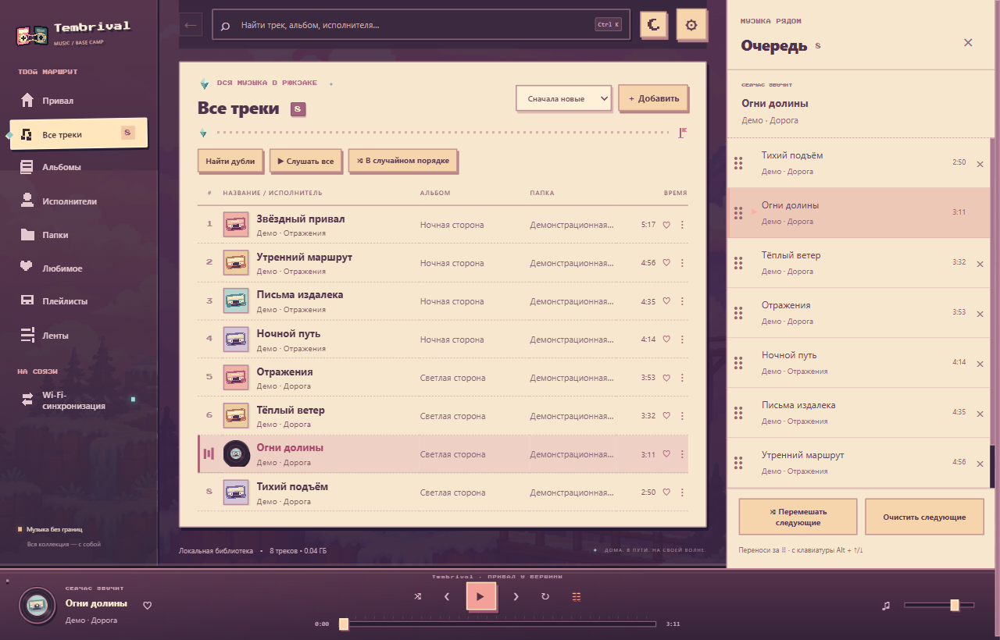
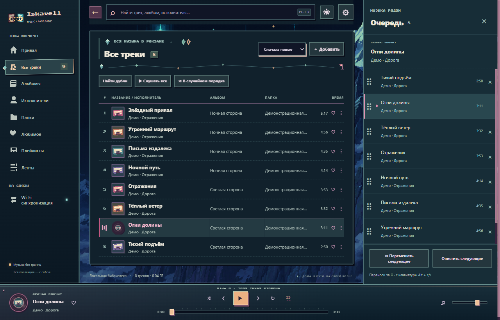

# Tembrival

Музыкальный плеер для Windows и Android с локальной библиотекой и передачей музыки между устройствами по Wi-Fi. Tembrival — дневная сторона интерфейса, Iskavell — ночная.

Разработчик — [NamelessHat](https://github.com/NamelessHat). [Официальный сайт](https://namelesshat.github.io/Tembrival/) уже доступен. Публичный выпуск приложения готовится; установочные файлы пока не размещены. Текущий кандидат — 0.21.1.

На скриншотах — демонстрационная библиотека Windows-версии 0.21.1.

## Возможности

- Локальные аудиофайлы, альбомы, исполнители, папки, плейлисты и избранное.
- Редактирование названий и обложек, очередь воспроизведения.
- Свои ленты из любого сочетания исполнителей, альбомов, плейлистов и отдельных треков: пересечения убираются по идентификатору песни, порядок перемешивается при запуске.
- Сохранение состава ленты и использование актуального содержимого её источников. Составы пока хранятся отдельно на каждом устройстве.
- Перестановка очереди за ручку, включая уже сыгравшие строки; боковая панель на широком экране и выдвижная очередь на телефоне.
- Передача музыки между Windows и Android, синхронизация плейлистов и избранного.
- Сопряжение через QR или вручную, поиск знакомого ПК и восстановление соединения.
- Работа через общий Wi-Fi или точку доступа телефона без интернета.
- Дневная и ночная темы, отключение анимаций.

Аккаунт не требуется. Аналитика и облачное хранилище библиотеки не используются. Публичная сборка не содержит загрузчика музыки из интернета.

## Установка и подключение

Windows 10/11 x64: распакуйте весь официальный ZIP и запустите Tembrival.exe. Android 8 и новее: установите официальный APK. При обновлении Android устанавливайте поверх прежней версии, не удаляя приложение.

Оба приложения работают самостоятельно. Для передачи подключите устройства к общей локальной сети, откройте Wi-Fi-синхронизацию на ПК и создайте пару. При ручном подключении сравните удостоверение ПК. [Подробная инструкция](docs/INSTALL.ru.md).

## Ограничения

- Для передачи устройства должны находиться в доступной друг другу локальной сети, а приложение на ПК должно работать. Удалённая синхронизация через интернет не предусмотрена.
- VPN, брандмауэр и изоляция клиентов Wi-Fi могут мешать соединению. Приложение не меняет эти настройки автоматически.
- Windows-сборка пока не подписана Authenticode. Не отключайте защиту системы ради установки.
- Первичная локальная страница выдачи APK использует HTTP и предназначена для доверенной сети. После сопряжения передача использует TLS с проверкой ключа ПК.
- Удаление треков очищает управляемые копии на текущем устройстве; исходные импортированные файлы ПК не удаляются.

## Обратная связь и поддержка

Разработчик: NamelessHat. Почта: NotHappyWolf@yandex.ru. В сообщении об ошибке укажите версию, устройство, шаги воспроизведения и результат. Не присылайте ключи подписи, пароли, QR сопряжения, PIN и токены доступа. Музыкальные файлы и полные журналы не нужны без отдельного запроса.

Приложение бесплатно. Добровольная финансовая поддержка возможна в будущем; способ и ссылка пока не настроены. Пожертвования не дают платных функций и не являются условием использования.

## Условия

Неизменённые официальные сборки разрешено распространять с сохранением авторства и полного комплекта документов. Собственные исходники планируется предоставлять по модели source available: изучение и личные изменения разрешены, распространение производных приложений требует разрешения. Это не лицензия Open Source. Точные условия сопровождают соответствующую поставку; сторонние компоненты сохраняют собственные лицензии.

Windows-комплект содержит уведомления Electron/Chromium и соответствующие исходники FFmpeg. Используйте музыку и обложки, на которые у вас есть необходимые права.

- [Условия использования и распространения официальных сборок](docs/TERMS-DRAFT.ru.md).
- [Условия доступа к собственным исходникам](docs/SOURCE-TERMS-DRAFT.ru.md). Их наличие не означает публикации всей рабочей папки.
- [Приватность](docs/PRIVACY.ru.md).
- [Сообщить об уязвимости](SECURITY.md).

Имена документов с DRAFT сохранены для совместимости; внутри указана дата редакции. Сторонние лицензии и соответствующие исходники FFmpeg поставляются вместе с приложением и не заменяются условиями собственных частей проекта.
